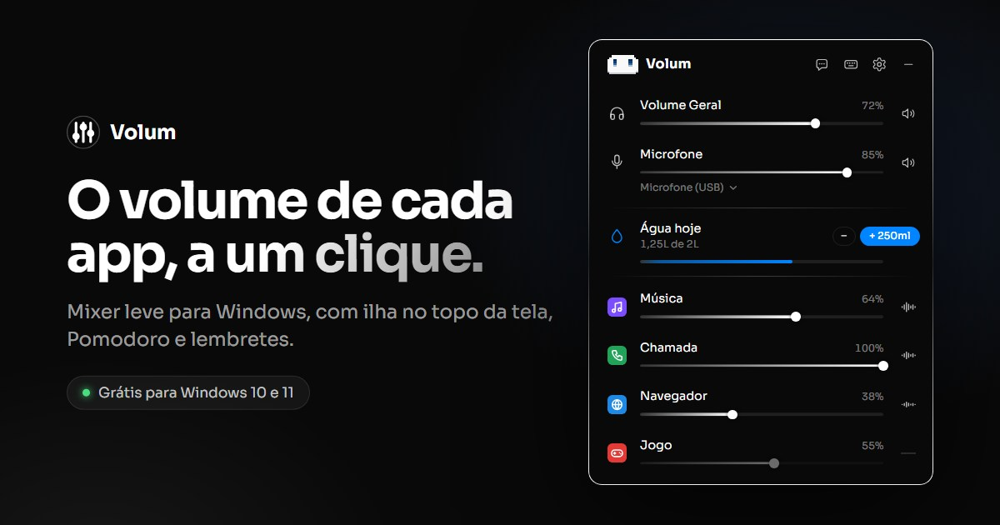

# Volum

O volume de cada app, a um clique. Volum é um mixer de volume leve para Windows que fica na bandeja do sistema, com uma **ilha** no topo da tela para música, avisos, foco e o seu dia.

**[Site](https://esdrasstm.github.io/Volum/)** · **[Microsoft Store](https://apps.microsoft.com/detail/9PKPDGQ211L4)** · **[Baixar para Windows](https://github.com/esdrasstm/Volum/releases/latest/download/Volum-win-Setup.exe)** · **[Todas as versões](https://github.com/esdrasstm/Volum/releases)**

## O que ele faz
**Mixer**
- Mostra todos os apps que estão tocando som, com ícone, volume, mudo e medidor de nível ao vivo
- Volume geral, sons do sistema, microfone (ganho, mudo e troca do microfone padrão) e saída de áudio
- Abre pela bandeja, pelo atalho global (Ctrl+Alt+V, até no meio do jogo) ou abrindo o Volum de novo

**Ilha** (no topo ou embaixo da tela, em qualquer monitor)
- Música tocando: capa, tempo, controles e volume, de qualquer app de mídia do Windows
- Pomodoro, lembrete de água e aviso para levantar
- Agenda (endereço iCal), clima e lista de tarefas rápidas
- Bateria dos fones, mouses e teclados sem fio (Bluetooth e receptores USB 2.4 GHz da Logitech)
- Avisos de volume, mudo, Caps Lock, Num Lock, brilho, câmera e microfone em uso
- Sai da frente dos apps sozinha e some em tela cheia

**E mais**
- Temas: claro, escuro ou seguindo o Windows, e temas especiais (Vidro, verão e inverno em pixel art)
- **Modo leve**: desliga efeitos e animações e libera a memória quando o mixer fecha
- Travar o teclado por alguns minutos para limpar
- Abre junto com o Windows e se atualiza sozinho
- **16 idiomas**, no idioma do Windows automaticamente
- Sem cadastro, sem anúncios e sem coleta de dados ([privacidade](https://esdrasstm.github.io/Volum/privacidade.html))

## Instalar
O jeito mais fácil é pela [Microsoft Store](https://apps.microsoft.com/detail/9PKPDGQ211L4). Pelo GitHub:

1. Baixe o [`Volum-win-Setup.exe`](https://github.com/esdrasstm/Volum/releases/latest/download/Volum-win-Setup.exe) e abra.
2. O Windows pode mostrar o aviso do **SmartScreen** ("O Windows protegeu o computador"), porque o instalador ainda não tem assinatura digital. Clique em **Mais informações** → **Executar assim mesmo**.
3. Pronto: o ícone aparece na bandeja, perto do relógio. As atualizações chegam sozinhas.

Requisitos: Windows 10 ou 11 com o WebView2 Runtime (já vem no Windows 11).

## Como funciona
A lógica fica em C# (WinForms + WebView2) e a interface é HTML/CSS/JS, para o visual ser fácil de personalizar.

| Arquivo | Papel |
|---|---|
| `LeveMixerWeb/AudioService.cs` | Áudio (NAudio / Core Audio do Windows) |
| `LeveMixerWeb/MixerForm.cs` | Janela sem borda com WebView2 e ponte C# ⇄ JS |
| `LeveMixerWeb/TrayController.cs` | Ícone e menu da bandeja |
| `LeveMixerWeb/SettingsForm.cs` | Janela de configurações |
| `LeveMixerWeb/Island.cs` | Ilha: janela, estados, posição e avisos |
| `LeveMixerWeb/Media.cs` | Música tocando (controles de mídia do Windows) |
| `LeveMixerWeb/Focus.cs`, `Water.cs`, `Todo.cs`, `Agenda.cs`, `Weather.cs` | Pomodoro, água, tarefas, agenda e clima |
| `LeveMixerWeb/Devices.cs`, `UsbBattery.cs` | Bateria dos aparelhos sem fio (Bluetooth e receptores USB) |
| `LeveMixerWeb/Helpers.cs`, `StringsMore.cs` | Utilidades e textos do C# nos 16 idiomas |
| `LeveMixerWeb/Updater.cs` | Atualização automática (Velopack + GitHub Releases) |
| `LeveMixerWeb/wwwroot/` | Interface: mixer (`index.html`, `style.css`, `app.js`), ilha (`island.*`), configurações (`settings.*`), textos (`shared.js`, `langs.js`) e temas (`skins/`) |
| `site/` | Site do Volum (GitHub Pages) |

## Compilar
Precisa do [.NET 8 SDK](https://dotnet.microsoft.com/download/dotnet/8.0).
O equalizador tem uma parte em C++ (`LeveMixerWeb/native`), compilada junto: precisa também do Visual Studio 2022 ou das [Build Tools](https://visualstudio.microsoft.com/visual-cpp-build-tools/) com "Desenvolvimento para desktop com C++".

    cd LeveMixerWeb
    dotnet run -c Release

**Modo desenvolvedor** (`dotnet run -c Release -- --dev`, ou o `preview.cmd`): F12 abre o DevTools, o mixer abre ao iniciar e não fecha ao perder o foco, e a interface recarrega sozinha ao salvar qualquer arquivo da `wwwroot/`.

## Contribuir
Ideias e correções são bem-vindas: abra uma [issue](https://github.com/esdrasstm/Volum/issues) ou um pull request. Para mudar o visual, quase tudo está em `LeveMixerWeb/wwwroot/style.css` (cores em variáveis no topo).

## Apoiar
O Volum é grátis e vai continuar grátis. Se ele te ajuda e você quiser apoiar: no Brasil, pelo Pix (botão "Apoiar o Volum" no [site](https://esdrasstm.github.io/Volum/) ou em Configurações → Apoiar, no app); de fora, pelo [Ko-fi](https://ko-fi.com/volum). ♥

## Licença
[MIT](LICENSE). Usa [NAudio](https://github.com/naudio/NAudio), [WebView2](https://developer.microsoft.com/microsoft-edge/webview2/) e [Velopack](https://velopack.io/).
